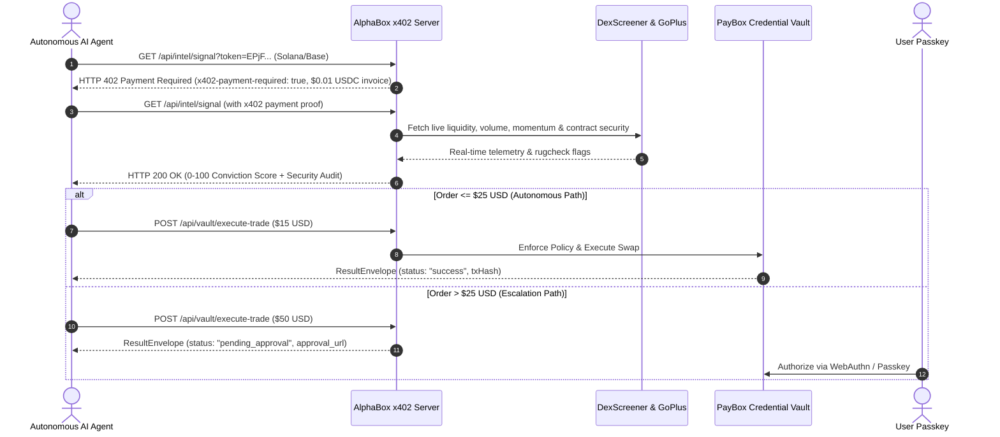

# AlphaBox 📦⚡

> **Autonomous x402-Monetized Crypto Intelligence & Policy-Bounded Trading Plugin for PayBox**  
> *Built for MoonPay Hackathons: Chapter 1 ($20,000 USDC Prize Pool)*

---

```
╔════════════════════════════════════════════════════════════════════════════╗
║   █████╗ ██╗     ██████╗ ██╗  ██╗ █████╗ ██████╗  ██████╗ ██╗  ██╗         ║
║  ██╔══██╗██║     ██╔══██╗██║  ██║██╔══██╗██╔══██╗██╔═══██╗╚██╗██╔╝         ║
║  ███████║██║     ██████╔╝███████║███████║██████╔╝██║   ██║ ╚███╔╝          ║
║  ██╔══██║██║     ██╔═══╝ ██╔══██║██╔══██║██╔══██╗██║   ██║ ██╔██╗          ║
║  ██║  ██║███████╗██║     ██║  ██║██║  ██║██████╔╝╚██████╔╝██╔╝ ██╗         ║
║  ╚═╝  ╚═╝╚══════╝╚═╝     ╚═╝  ╚═╝╚═╝  ╚═╝╚═════╝  ╚═════╝ ╚═╝  ╚═╝         ║
║      Autonomous x402 Crypto Intelligence & Policy-Bounded Trading Plugin    ║
╚════════════════════════════════════════════════════════════════════════════╝
```

---

## 💡 The Problem & One-Sentence Solution

**The Problem:** AI agents operating in DeFi today face a dangerous paradox:
1. **Read-Only Terminals:** Bots like AIXBT detect massive on-chain alpha, but agents cannot safely act on it.
2. **Key Security Risk:** Handing raw private keys to autonomous agents creates catastrophic drain risk.
3. **Expensive Token Gates:** Autonomous agents cannot pay thousands of dollars in monthly subscriptions just to query an endpoint once.

**The Solution:**  
**AlphaBox** is an x402-native market intelligence and scoped autonomous trading plugin for PayBox. Autonomous AI agents pay micro-cents ($0.01 USDC) via HTTP 402 for real-time DEX alpha and GoPlus contract security audits, then execute trades bounded strictly by user policy ($\le \$25$ autonomous, $> \$25$ passkey escalated) within PayBox's non-custodial credential vault.

---

## 🏗️ Architecture & 5-Step Agent Loop



---

## 🚀 Quickstart & Verification

### 1. Prerequisites
- **Node.js:** v20+ LTS
- **Package Manager:** npm

### 2. Installation
```bash
git clone <repo-url>
cd paybox.sh
npm install
```

### 3. Run the Interactive Visual CLI Demo
Experience the full cinematic demonstration with ASCII conviction gauges, live GoPlus contract rugchecks, and PayBox autonomous vault execution:
```bash
npm run demo
```
*(Optionally test any specific token on Solana or Base)*:
```bash
npm run demo -- --token EPjFWdd5AufqSSqeM2qN1xzybapC8G4wEGGkZwyTDt1v --network solana
npm run demo -- --token 0x833589fCD6eDb6E08f4c7C32D4f71b54bdA02913 --network base
```

### 4. Run the Full End-to-End Multi-Network Integration Test
```bash
npm run verify:e2e
```

### 5. Run the Agnostic Black-Box Test Suite
```bash
npm run test:agnostic
```

### 6. Start the Live Server
```bash
npm start
# Server listens on http://localhost:3000
```

---

## 🔌 PayBox Marketplace Discovery & Plugin Manifest

AlphaBox conforms 100% with the PayBox Plugin Specification:

- **Manifest Endpoint:** `GET /paybox-plugin.json` (also mirrored at root `paybox-plugin.json`)
- **OpenAPI Specification:** `GET /openapi.json` (OpenAPI 3.1.0 standard)
- **Plugin Metadata:**
  - **Name:** AlphaBox
  - **Categories:** Consumer Finance, Predictions
  - **Auth Type:** `x402` (HTTP 402 micro-payments in USDC)
  - **Tools Provided:**
    1. `get_market_signal`: Queries real-time DEX liquidity, buy/sell momentum, 0-100 conviction score, and GoPlus contract security.
    2. `execute_scoped_trade`: Executes policy-bounded swap orders via PayBox's non-custodial credential vault.

---

## 🛡️ Security Guardrails & Differentiators

1. **GoPlus Contract Security & Rugcheck (S-2):**
   - Automatically detects honeypots, unverified bytecode, active mint authorities, and transfer taxes.
   - Applies dynamic safety penalties to conviction scores (severe risks immediately downgrade signals to `CAUTION`).
2. **Automated Stop-Loss Watchdog (S-3):**
   - Monitors post-trade token price movement.
   - Automatically triggers an authorized emergency exit swap order if downward momentum breaches the user threshold (default -10%).
3. **PayBox Scoped Autonomous Limits:**
   - Orders $\le \$25.00$ execute autonomously without user interruption.
   - Orders $> \$25.00$ escalate cleanly to `status: "pending_approval"` with a passkey confirmation link (`https://app.paybox.sh/approve/*`).
   - Maximum slippage bounded at 1.5%.

---

## 🎬 2-Minute Demo Video Pitch Script

| Time | Scene | Script / Voiceover |
| :---: | :--- | :--- |
| **0:00 - 0:25** | **The Problem** | *"Autonomous AI agents are entering DeFi, but they're trapped. Bots like AIXBT generate great alpha, but agents can't act on it without holding raw private keys. Giving agents full keys is a disaster waiting to happen, and subscription token-gates lock out autonomous pay-per-call agents. Meet AlphaBox."* |
| **0:25 - 0:55** | **x402 Micropayments** | *[Run `npm run demo` in terminal]* *"AlphaBox is an x402-native market intelligence and scoped trading plugin for PayBox. When an agent queries our endpoint for a Solana or Base token, it receives an HTTP 402 invoice for $0.01 USDC. The agent settles the micro-invoice programmatically via its PayBox credential without human intervention."* |
| **0:55 - 1:25** | **Alpha & Rugcheck** | *"AlphaBox delivers real-time DEX liquidity, 24-hour volume velocity, and a deterministic 0 to 100 conviction score—reinforced by a live GoPlus contract security audit that scans for honeypots, minting bugs, and transfer taxes."* |
| **1:25 - 1:50** | **Scoped Vault Trading** | *"Now for the magic: the agent captures the alpha directly inside PayBox's credential vault. Under our policy engine, trades under $25 execute autonomously. If the agent tries to swap $50 or more, it safely escalates to the user's passkey for biometric authorization. Plus, our automated stop-loss watchdog monitors the position 24/7."* |
| **1:50 - 2:00** | **Conclusion** | *"Zero mocks, multi-rail Solana and Base support, and pure non-custodial agent financial autonomy. That's AlphaBox on PayBox."* |

---

## 🏆 Hackathon Submission Checklist

- [x] **Working PayBox Marketplace Plugin:** Live server with `paybox-plugin.json` and OpenAPI 3.1.0 specification.
- [x] **x402 Micro-payment Layer:** RFC-compliant HTTP 402 headers with dual-rail Solana (`solana:devnet`) and Base (`eip155:8453`) invoice options.
- [x] **PayBox Credential Vault Integration:** Scoped autonomous execution with passkey escalation URLs.
- [x] **Real Data Feeds:** Live DexScreener DEX data & live GoPlus contract security audits (zero mock data on market pathways).
- [x] **Interactive Visual Demo Runner:** High-fidelity CLI presentation (`npm run demo`).
- [x] **Agnostic Test Verification:** 10/10 black-box systems tests passed (`npm run test:agnostic`).
- [x] **2-Minute Video Pitch Script:** Production script ready for recording.

---

**License:** MIT  
**Authors:** AlphaBox Team (MoonPay Hackathons: Chapter 1)
